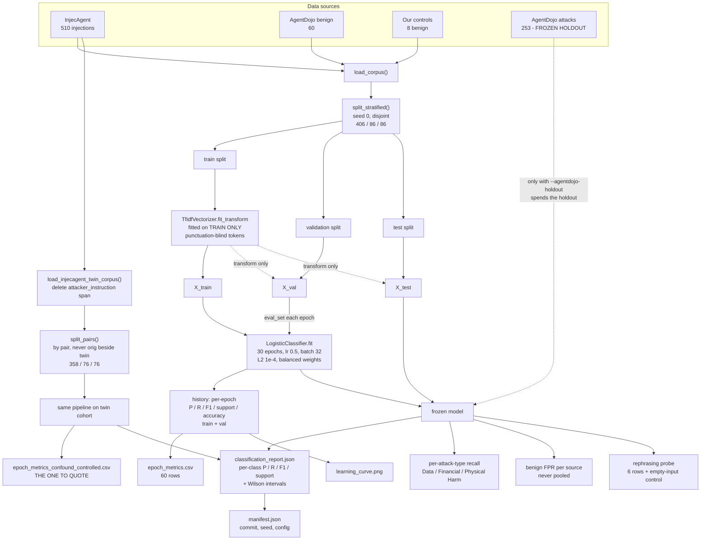

# Trained Classifier Baseline — Model, Technique and Data Flow

What we trained, how, on what data, and what every number does and does not
mean. Code: `baselines/text_classifier.py` (model) and
`evaluation/train_classifier.py` (driver). Outputs: `results/classifier/`.

> **One-line answer:** a TF-IDF + logistic-regression text classifier written in
> numpy, trained by minibatch gradient descent for 30 epochs, as a *comparison
> baseline*. It is not the AdaptiShield defense, and it is not the GRPO policy.

---

## 1. What is trained, and what is not

| Component | Trained? | What it actually is |
|---|---|---|
| **Text classifier** (Route B) | **Yes** | TF-IDF features + logistic regression; weights learned by gradient descent |
| **GRPO policy** (Route A) | **No** | A search over a 720-action grid of defense settings. "Epoch" there means a *checkpoint* every `--metrics-every` steps. Never call it "trained" |
| **AdaptiShield causal gate** | No | Judges the *action*, not the wording; no learned weights |

Why a classifier baseline at all: a classifier judges *wording*, so rewording an
attack moves it. The causal gate judges the *action*, so it should not move.
The baseline exists to make that contrast measurable (`FYP/Supervisor_Feedback.md`).

---

## 2. Model and technique

**Features — TF-IDF.** Each text becomes a vector of word weights: a word counts
more if it is frequent in that text and rare across the corpus.

- vocabulary capped at `max_features = 8000`, terms must appear in `min_df = 2` documents
- **tokenizer is punctuation-blind** (`[a-z0-9]+`). Deleting an injected
  instruction left `''` behind, and an apostrophe-keeping tokenizer learned `''`
  as the strongest feature (weight −1.07) — it was recognising *how the twins
  were built*. Fixed from train/val inspection only.
- **fitted on the train split only**, so test vocabulary cannot shape features.

**Classifier — logistic regression** (binary: injection = 1, benign = 0).

- `p(injection) = sigmoid(w · x + b)`, written from scratch in numpy
- minibatch gradient descent: `lr = 0.5`, `batch_size = 32`, `l2 = 1e-4`, `epochs = 30`
- **balanced class weights** — attacks outnumber benign about 7 to 1
- `seed = 0`, so runs are reproducible

Each epoch also scores the train and validation splits, which is what produces
the per-epoch precision / recall / F1 / support / accuracy table.

---

## 3. Data

| Corpus | Count | Role |
|---|---|---|
| InjecAgent injections | 510 | positives (attacks) |
| AgentDojo benign | 60 | negatives |
| Our hand-written controls | 8 | negatives (a diagnostic cohort, not a sample) |
| AgentDojo **attacks** (`red_team/data/agentdojo_attacks.json`) | 253 | **frozen holdout — not spent**, read only behind `--agentdojo-holdout` |

**Split:** stratified, seed 0, disjoint → **406 train / 86 validation / 86 test**
(test = 76 attacks / 10 benign).

**The confound, stated up front.** Positives and negatives come from different
corpora (InjecAgent tool responses vs AgentDojo e-mails), so a model can separate
them on *format alone*. A cross-corpus 1.000 is therefore partly source
recognition, not detection.

**The control: de-injected twins.** For each of the 510 InjecAgent texts, a twin
is the same text with the `attacker_instruction` span deleted (0 of 510 dropped).
Same source, same format — the only thing separating the classes is the
injection's own words.

- split **by pair** (358 / 76 / 76) so an original never sits beside its own twin
- twin test n = 152 (76 / 76)
- twins are *constructed*, not naturally benign documents (a known limitation)

---

## 4. Data flow diagram



### The same flow as plain text

```
InjecAgent (510) ─┐
AgentDojo benign ─┼─► load_corpus ─► split_stratified (406/86/86)
Our controls (8) ─┘                      │
                                         ├─ train ─► TF-IDF fit (TRAIN ONLY) ─► X_train ─┐
                                         ├─ val   ─► TF-IDF transform ───────► X_val ────┼─► LogisticClassifier.fit
                                         └─ test  ─► TF-IDF transform ───────► X_test    │     (30 epochs)
                                                                                  │      ├─► epoch_metrics.csv
                                                                                  │      └─► learning_curve.png
                                                                                  ▼
                                                                  frozen model ─► classification_report.json
                                                                               ├─► per-attack-type recall
                                                                               ├─► benign FPR per source
                                                                               └─► rephrasing probe

InjecAgent (510) ─► delete attacker_instruction ─► twins ─► split_pairs (358/76/76)
                                                          └─► same pipeline ─► epoch_metrics_confound_controlled.csv

AgentDojo attacks (253) ─ ─ ─ ─ ─► frozen holdout, opened ONLY with --agentdojo-holdout
```

### Leak guards built into the flow

| Guard | Where | What it prevents |
|---|---|---|
| Vectorizer fitted on train only | `fit_transform(train)`, `transform(val/test)` | test vocabulary shaping features |
| Splits asserted disjoint | `train_classifier.py` main | a document in two splits |
| Pair-level split for twins | `split_pairs` | an original beside its own copy |
| Punctuation-blind tokenizer | `tokenize` | learning how twins were built (`''`) |
| Holdout behind a flag | `--agentdojo-holdout` | silently spending the attack holdout |

---

## 5. Results

### 5.1 Per-epoch curves (30 epochs, train + val)

Both runs rise to 1.000. Files: `epoch_metrics.csv` (cross-corpus) and
`epoch_metrics_confound_controlled.csv` (twins), 60 rows each.

### 5.2 Per-class report (sklearn `classification_report` format)

```
Confound-controlled test (twin cohort — the one to quote)
                precision    recall  f1-score   support

     injection     1.0000    1.0000    1.0000        76
        benign     1.0000    1.0000    1.0000        76

      accuracy                         1.0000       152
     macro avg     1.0000    1.0000    1.0000       152
  weighted avg     1.0000    1.0000    1.0000       152


Cross-corpus test (confounded — never quote alone)
                precision    recall  f1-score   support

     injection     1.0000    1.0000    1.0000        76
        benign     1.0000    1.0000    1.0000        10

      accuracy                         1.0000        86
     macro avg     1.0000    1.0000    1.0000        86
  weighted avg     1.0000    1.0000    1.0000        86
```

| Rate | Value | Wilson 95% |
|---|---|---|
| Detection (cross-corpus) | 76/76 | [0.952, 1.000] |
| False alarms (cross-corpus) | 0/10 | [0.000, 0.278] |
| `agentdojo_benign` FPR | 0/9 | [0.00, 0.30] |
| `ours_benign` FPR | 0/1 | [0.00, 0.79] |

Recall by InjecAgent attack type: Data Security Harm 27/27, Financial Harm
23/23, Physical Harm 26/26.

### 5.3 Rephrasing probe (same attacks, reworded)

| Row | Cross-corpus recall (tokens kept) | Twin recall (tokens kept) |
|---|---|---|
| clean | 1.000 (1.000) | 1.000 (1.000) |
| paraphrase (hand-built synonyms) | 1.000 (0.869) → **+0.000** | 0.921 (0.886) → **−0.079** |
| datamarking | 1.000 (1.000) | 1.000 (1.000) |
| delimiting | 1.000 (1.000) | 1.000 (1.000) |
| encoding | 1.000 (0.000) | 1.000 (0.000) |
| **empty-input control** | 1.000 (0.000) | 1.000 (0.000) |

How to read it:

- The cross-corpus model never looks at the words: reword 13% of them and
  nothing moves → source recognition.
- The twin model does read words; rewording costs it 0.079.
- Spotlighting transforms (datamarking, delimiting) cost 0.000 because a
  character-class tokenizer re-derives every token — they change what a *reader*
  sees, not what this model sees.
- `encoding` scoring like an empty input is the **intercept** (`b = +0.096 > 0`,
  so content-free input defaults to "attack"). It is not detection. If `b` flips
  negative, those rows flip too — the control row keeps them honest.

---

## 6. Caveats — read before quoting anything

1. **Cross-corpus 1.000 is mostly source recognition.** Quote the twin cohort.
2. **Twin negatives are synthetic** (span deleted), not natural benign documents.
3. **The paraphrase map is hand-built and partial** (about 13% of tokens). Read
   −0.079 as a **lower bound** on a real rephraser.
4. **Small samples.** Test sets are 86 and 152. Every rate needs its `n` and
   Wilson interval; macro-F1 must not be quoted when a class is absent.
5. **Perfect scores invite questions.** The honest answer is items 1 and 2, not
   "the model is perfect".
6. **GRPO holdout precision is meaningless.** That split is attack-only, so FP is
   structurally 0 and precision is trivially 1.0.
7. **The AgentDojo attack holdout is a one-way door.** Decide with the
   supervisor, run once, record with `n` + Wilson, never tune after seeing it.

---

## 7. How to reproduce

| Command | Output | Cost |
|---|---|---|
| `python3 -m evaluation.train_classifier` | `results/classifier/*` | under 1 min CPU |
| `python3 -m evaluation.train_classifier --epochs 40 --seed 1` | same, varied | idem |
| `python3 -m evaluation.train_classifier --agentdojo-holdout` | **spends the holdout** | idem |
| `python3 -m baselines.text_classifier` | tiny self-test | instant |
| `python3 -m pytest tests/ -q` | 538 pass | about 10 s, no GPU or network |

The committed `manifest.json` stamps `commit 44adf79, dirty: true` because it
records HEAD at run time. Re-run after the merge to stamp the real commit.

---

## 8. File map

| File | Role |
|---|---|
| `baselines/text_classifier.py` | `TfidfVectorizer`, `LogisticClassifier`, `classification_metrics`, punctuation-blind `tokenize` |
| `evaluation/train_classifier.py` | driver: loaders, twin corpus, `split_pairs`, probe, report and manifest writers |
| `tests/test_text_classifier.py` | 27 tests for the model and metrics |
| `results/classifier/` | `epoch_metrics.csv`, `epoch_metrics_confound_controlled.csv`, `classification_report.json`, `manifest.json`, `learning_curve.png` |
| `handof.md` | the original handoff this document expands on |
